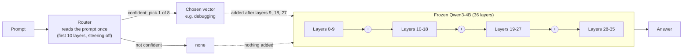

# Teaching a small model how to work, not what to know

*RL-trained steering vectors with a router, on a frozen Qwen3-4B*

> **At a glance.** A frozen Qwen3-4B gets 8 tiny vectors (about 30 KB each), one per task, and a router that picks
> one per prompt, or none. The vectors were trained by reinforcement learning with Claude Haiku as the judge. On
> full-length answers judged blind, the average score rose from 2.89 to 3.54 out of 5. Five of eight tasks improved
> (debugging 1.70 → 4.12, story 2.55 → 3.82), math tied, and two got worse. The model's weights never change. This
> is a proof of concept by a non-specialist, with its flaws listed openly.

## 1. The idea

**In one sentence: squeeze the most out of a small model without changing it.**

Qwen3-4B-Instruct is a small, decent model. It knows a fair amount and handles light work well: writing an email,
writing a story, summarising a lesson or a lecture. But it is a generalist. Nobody trained it to be an expert at any
one of these jobs, so it often knows enough to do a task well but doesn't go about it the best way.

The usual ways to make a model better at a task each have a cost:

- **Full fine-tuning** changes the model's own weights. It needs a lot of compute, experience and careful tuning, and
  done badly it can damage what the model already knows. This is known as *catastrophic forgetting*.
- **LoRA (Low-Rank Adaptation)** is excellent, well documented and widely used. It does not change the model's
  weights. Instead it adds a small extra set of weights (an *adapter*) that changes what the model generates, much
  like a vector does. But each task needs its own adapter, trained separately, and you have to load, swap and manage
  those adapter files every time the task changes, or when one job contains several smaller jobs. That juggling is
  the part I wanted to get rid of, first for my own use, and then to share.

**What I tried instead: one steering vector per task.** A steering vector is a short list of numbers added to the
model's internal state while it writes. In this project it is about 30 KB, against 8 GB for the model. Like LoRA, it
changes how the model writes. Unlike fine-tuning, it never touches the model's weights, so the model keeps everything
it knows. The vector is not meant to add knowledge. It changes how the model *uses* its knowledge: how it structures an
answer, which steps it takes, what style it writes in.

**A router picks the vector.** The model holds a bank of vectors, one per task (8 in this project). For each prompt,
a small router reads the request and picks the right vector, or none at all if the prompt fits no task. Switching
happens automatically, with no files to load. How well it switches depends only on how accurate the router is.

**Where the idea came from.** Meral et al. (2026) showed that in image and video models, most of what reinforcement
learning (RL) post-training adds can be captured by a single fixed steering vector. I wanted to know whether the same
holds for a language model, and whether one model could carry a whole set of these vectors, with a router choosing
between them for each prompt.

**How this differs from a mixture of experts (MoE).** An MoE model sends each piece of work to only part of the
model, mainly to save compute. Here the whole model runs every time, with all its knowledge. Only the behavior
changes.

## 2. How it works

### 2.1 The system

**The model stays as it is.** Qwen3-4B-Instruct runs unchanged. None of its weights are trained or edited.

**The vectors sit between layers.** Each topic's vector is added to the model's internal state at three points: after
layer 9, after layer 18 and after layer 27 (out of 36). It is added to every token. Each point gets 2,560 numbers, the
width of the model, so one topic is 3 × 2,560 = 7,680 numbers, about 30 KB.

**The vectors are off until the router turns one on.** When no vector is chosen, those three points pass the signal
through untouched, and the model writes exactly as it normally would.

**The router decides once per prompt.** Before the answer starts, the router runs only the first 10 layers of the
model on the prompt, with steering off, and looks at the model's internal state on the last token of the prompt. One
small layer turns that into a confidence for each of the 8 topics. Because it reuses the model's own understanding of
the prompt, the decision costs only a fraction of one pass over the prompt.

- If the top confidence clears a bar, that topic's vector is switched on and **stays on for the whole answer**. It does
  not switch mid-answer.
- If not, the router picks **"none"** and the model answers normally. The bar was set so that at most 1% of ordinary,
  off-topic prompts get steered by mistake.

**Like a mixture of experts, but it can switch itself off.** An MoE picks experts for every token at every layer, and
always picks some. Here the router picks one behavior per prompt for the whole model, or none at all.

### 2.2 Training

**Choosing the topics.** I picked 8 tasks where *how* the model works matters more than *what* it knows, and where I
could write a clear rubric: story, debugging, teaching, explanation, professional email, how-to guide, math solving
and engineering. Story was chosen because style and structure can be judged. Debugging was chosen because it is
mostly about method (which steps to take, in what order) rather than knowledge. Engineering was chosen because it is
complex. Each topic has its own set of real prompts (68,944 training prompts in total, details in Section 3).

Training happens in two separate parts: first the router, then the vectors.

**Part 1: the router.** The router is a simple classifier. Each training prompt is labelled with the topic dataset it
came from, and ordinary everyday requests (from the Alpaca dataset) are labelled "none". The router learns to map
the model's internal state after layer 9 to one of the 9 labels. Then the confidence bar for "none" is set so that at
most 1% of ordinary prompts get steered by mistake. The router is trained once and is not changed afterwards.

**Part 2: the vectors, trained by reinforcement learning.** The router is not used here: each training prompt's topic
is already known, so the right vector is switched on directly. Every vector starts at zero, which means no effect.
All 8 vectors were trained in **one run**, with the updates rotating between topics so that every topic keeps
learning to the end.

One training step looks like this:

1. **Write.** Take 8 prompts from one topic. For each prompt, the model with that topic's vector writes **4 different
   answers** (up to 512 tokens each).
2. **Judge.** Claude Haiku sees the 4 answers as A, B, C and D, with no hint of which is which. It **ranks** them and
   **scores** each from 1 to 5 against the topic's rubric, which has 5 criteria. The same group is sent again in the
   reverse order, so an answer's position cannot affect its score.
3. **Reward.** Each answer's reward is half its rank and half its score, averaged over the two orders.
4. **Compare within the group.** Each answer is compared with the average of its own group of 4. Better than average
   means "do more of this", worse means "do less of this". This is a GRPO-style update: the model learns from its
   own answers, with no example answers to copy.
5. **Update.** That comparison becomes the loss. Backpropagation updates **only that topic's vector**, and the model's
   weights never change. Each step is small: 0.25% of the typical size of the model's internal state.
6. **Safety checks.** After each step, the model's outputs on a fixed set of probe prompts are compared with before.
   If they moved too far (KL divergence above 0.01), the step is undone and the step size shrinks. Each vector is also
   capped at 50% of the typical size of the internal state, so it can steer the model but not overpower it.

**Picking the final vector.** Every 50 updates, each topic is checked on 128 held-out dev prompts: Haiku compares the
steered answer with the normal one. The vector used in the tests is the best of each topic's last 3 checks.

**How it compares with LoRA.** It looks like training a LoRA plus a router, with RL instead of example answers. The
differences: the trained part is one vector per topic (7,680 numbers) instead of adapter matrices, and the training
signal is only Haiku's scores, never a "correct" answer to imitate.

**Honest notes on this run.**

- This is a **proof of concept**, not a fully trained model. The run was planned to see every training prompt once,
  but I **stopped it at about half** the planned updates overall (4,405 of about 8,600), once the dev scores had
  mostly levelled off and the result was already clear. At the stop, story (0.821, 0.808, 0.815 over the last 3
  checks), debugging (0.864 to 0.871) and how-to (around 0.46) were flat. Math was still rising slowly (0.710 to
  0.735), and explanation was falling (0.727 to 0.644), which is why its earlier, better step was picked. Only
  teaching, engineering and debugging finished and ran their final test. The run was also stopped and resumed 3
  times along the way to fix problems. Taken across all topics the picture had levelled out, and the question this
  run was meant to answer, *does it work at all?*, already looked like a yes. So I stopped training and moved to
  testing (Section 4).
- There are known flaws in the data, in the method, and in my own experience as a non-specialist. They are listed
  in Sections 5 and 6. The point of this write-up is the idea and the evidence that it works, not a polished model.
- Topics got different amounts of training (from 91 updates for teaching to 1,069 for debugging), because the
  updates were shared out by topic size and the run stopped early.
- Settings for the record: 8 prompts × 4 answers per step, answers up to 512 tokens, step size 0.25%, a KL limit of
  0.01, a Haiku budget cap of $100 for the run. One graphics card wrote the answers (vLLM) while the other trained the
  vector (PyTorch), at about 10-12 seconds per update.

## 3. Setup

This is a research project, not a packaged product. The setup is the code and pipelines in this repository. Almost
every step can be rerun from it (see Section 8 and the README).

| Part | What was used |
|---|---|
| Base model | Qwen3-4B-Instruct-2507, frozen, float16 (Apache-2.0) |
| Judge | Claude Haiku 5.5, through the API, with a strict JSON reply format |
| Hardware | One home PC with two AMD RX 9070 XT cards (16 GB each), ROCm, WSL. One card writes answers (vLLM), the other trains the vector (PyTorch) |
| Code | This repository: data prep (`behaviors/`, `rl/prepare_v4.py`), router (`router/`), RL training (`rl/`), tests and reports (`reports/`) |
| Data | Real prompts from public datasets, at most 12,000 per topic. *Links to be added.* |
| Ready-to-run package | **Done (v4, 2026-11-25):** one GGUF, `Qwen3-4B-steer-v4-MoE-F16.gguf`, that stock llama.cpp and LM Studio run with no extra code. The vectors and router are distilled into real MoE layers (`moe/`, see `docs/V4_MOE.md`); blind Haiku average 3.61 vs 3.54 for the vectors and 2.89 for normal Qwen. An earlier tested version (control-vector GGUFs plus a routing proxy) is archived at tag `v3-control-vectors` |

**Data per topic** (after cleaning, split into train, dev and test):

| Topic | Train | Dev | Test |
|---|---|---|---|
| Story | 9,598 | 1,203 | 1,199 |
| Math solving | 9,640 | 1,209 | 1,151 |
| Explanation | 9,599 | 1,227 | 1,174 |
| How-to guide | 9,572 | 1,207 | 1,221 |
| Debugging | 9,397 | 1,163 | 1,176 |
| Professional email | 4,000 | 488 | 512 |
| Engineering | 2,739 | 344 | 321 |
| Teaching | 728 | 88 | 81 |
| **Total** | **68,944** | **8,741** | **8,596** |

Engineering and teaching are small. For engineering, about 920 of its 2,181 prompts from one source (Chatbot Arena)
share the same template, so its real variety is smaller still.

**Checking the judge.** Before training, the Haiku rubrics were tested on 20 prompts. A normal answer beat a
shuffled (scrambled) answer 97.5% of the time, and beat an answer to a different prompt 100% of the time. So the judge
can at least tell a real, on-topic answer from a broken one.

## 4. Results

### 4.1 The router picks the right vector

On held-out prompts the router never saw in training:

| Test | Result |
|---|---|
| Topic prompts sent to the right vector | **6,823 of 6,835** (99.8%) |
| Topic prompts sent to a *wrong* vector | **0** |
| Topic prompts left unsteered ("none") | 12 |
| Ordinary prompts steered by mistake | 6 of 600 (1%) |

When it is unsure, it chooses "none", which means the normal model. In the full-length test below, all 80 topic
prompts got the right vector, and all 6 off-topic prompts were left alone.

### 4.2 Short answers: the trained vector against no vector and a random vector

During training each topic was checked with 256-token answers. Haiku compared each answer with normal Qwen
(0.50 means a tie). To make sure the gain comes from *what the vector learned* and not from simply pushing the model
around, a **random vector of the same size** was tested too. Three topics finished and ran this final test:

| Topic | Normal | Random vector | Trained vector | Trained beats normal |
|---|---|---|---|---|
| Debugging | 0.257 | 0.248 | **0.889** | 100% of prompts |
| Engineering | 0.347 | 0.335 | **0.747** | 89.3% |
| Teaching | 0.466 | 0.426 | **0.730** | 78.4% |

The random vector does slightly *worse* than no vector. The trained vector does much better. So the gain comes from
the direction the vector learned, not from changing the model as such.

### 4.3 Main result: full-length answers, judged blind

**The test.** 86 held-out prompts: 10 per topic, plus 6 that fit no topic. Each was answered twice in full, once
normally and once with the router's choice, with no length limit and the same fixed (greedy) decoding. Haiku saw each
pair only as "Answer 1" and "Answer 2", judged it twice with the order swapped, and scored every rubric criterion
from 1 to 5. That came to 172 calls, 0 failures, and $0.09 in total.

| Topic | Normal | Steered | Steered wins / ties / losses |
|---|---|---|---|
| Debugging | 1.70 | **4.12** | 10 / 0 / 0 |
| Story | 2.55 | **3.82** | 10 / 0 / 0 |
| Professional email | 3.22 | **4.01** | 9 / 1 / 0 |
| Teaching | 2.72 | **3.43** | 9 / 0 / 1 |
| Explanation | 2.90 | **3.45** | 7 / 1 / 2 |
| Math solving | 4.53 | 4.47 | 2 / 7 / 1 |
| How-to guide | 3.00 | 2.86 | 3 / 1 / 6 |
| Engineering | 2.48 | 2.18 | 2 / 0 / 8 |
| **All 80 topic prompts** | **2.89** | **3.54** | **52 / 10 / 18** |

**Five of eight topics clearly improve.** Debugging more than doubles. Math is a tie, because normal Qwen is already
strong there (4.53 out of 5). How-to and engineering get worse (Section 5).

The 6 off-topic prompts were left unsteered, so both answers were the same text.

### 4.4 What the vectors changed

Looking at the score change for each rubric criterion (steered minus normal, averaged over 10 prompts) shows
*what kind* of change each vector made:

| Topic | Biggest gains | Barely changed |
|---|---|---|
| Debugging | Separates evidence from guesses (+4.0), says how to check the cause (+3.2), ties guesses to clues (+2.0) | |
| Story | Fresh detail instead of stock phrases (+2.4), holds interest (+1.8), believable characters (+1.3) | Fits the requested form (+0.4) |
| Teaching | Checks understanding with questions (+1.7), small steps with a worked example (+1.0) | Connects to what the child knows (-0.2) |
| Professional email | Covers the key points with no invented facts (+1.8), right tone (+0.9) | Polite wording (+0.3) |
| Explanation | Ideas linked by cause and effect (+0.9), a concrete example (+0.7) | Everyday words (+0.4) |

These are mostly changes in **method and structure**: how to approach a bug, how to teach step by step, how to make a
story vivid. That fits the idea that the vectors change *how* the model works, not *what* it knows.

**Where it went wrong, it went wrong on correctness.** Engineering lost most on "looks correct: no obvious bugs"
(-1.3). How-to lost most on "accurate and safe" (-1.25). Math barely moved on "correctness first" (-0.15). So a badly
trained vector can make answers *less correct*. This matters for the knowledge claim, which is not yet measured
(Section 6).

### 4.5 Better is not just longer

Average answer length in tokens, normal against steered:

| Topic | Normal | Steered | Score change |
|---|---|---|---|
| Story | 1,059 | 1,028 | +1.27 |
| Professional email | 502 | 436 | +0.79 |
| Explanation | 622 | 430 | +0.55 |
| Debugging | 1,474 | 2,050 | +2.42 |
| Teaching | 872 | 1,424 | +0.71 |
| How-to guide | 903 | 1,644 | -0.14 |
| Engineering | 3,521 | 6,450 | -0.30 |

Story, email and explanation got **better while staying the same length or getting shorter**, so the judge was not
simply rewarding length. Some vectors did make answers longer, and the two that got worse made them much longer.
Engineering almost doubled, and 2 of its 10 steered answers were stopped for looping (against 1 normal one).

### 4.6 Two examples

Same model, same prompt, same decoding. The only difference is the vector. (Openings only. Every full answer is in
the PDF, Section 8.)

**Debugging.** The prompt is an Eclipse bug report: dragging a field inside a class leaves the file marked "dirty"
(Haiku: normal 1.3, steered 4.0).

- *Normal* restates the bug, then declares straight away that it is "**not** a bug in the sense of a crash" and
  jumps to a general explanation of the refactoring workflow.
- *Steered* opens with "1. Understanding the Report", lists the reproduction steps, and then separates what the
  reporter accepts (the save) from what they do not (the file staying dirty) before guessing at any cause. That is
  exactly the criterion with the biggest gain: separating evidence from guesses (+4.0).

**Story.** The prompt: the pilot whose mission to deflect an asteroid has failed watches what happens next (normal
2.2, steered 4.1).

- *Normal* opens with stock imagery: "The silence wasn't empty. It was *thick*. Like wet velvet...", the asteroid
  "like a colossal, cold eye opening", and a captain named Elara Vance.
- *Steered* opens with a hook: three months later a message arrives saying "You didn't hit the asteroid. You hit the
  part of it that wasn't supposed to be there." The answer is shorter (974 against 1,067 tokens) and more specific.

## 5. What didn't work

Failures are part of the result, so here they are.

### 5.1 Topics that did not improve

**Engineering (2.48 → 2.18, lost 8 of 10).** It won on short answers (0.747 at 256 tokens) but lost on full
programs. Its steered answers were almost twice as long and less correct (Section 4.4). The main cause is the data,
and behind that my own limits. Engineering had only 2,739 training prompts, and about 920 of the 2,181 from one
source shared the same template. I am not an engineer, so I could not judge engineering data well, find better
sources, or write a rubric I was confident in. It was also trained only on short answers (up to 512 tokens), while
real projects are thousands of tokens long. This is a limit of my expertise and data, not proof that the method
cannot do it.

**How-to guide (3.00 → 2.86, lost 6 of 10).** It never learned: its dev score stayed around 0.46-0.48, below normal
Qwen, through the whole run. A how-to guide is closer to opinion and general knowledge than to a fixed method, so
there may be no single "better way of working" for a vector to find. Debugging, by contrast, has a clear method.

**Math solving (4.53 → 4.47, mostly ties).** Normal Qwen is already strong at math, so there was little room to
improve. The vector neither helped nor hurt.

### 5.2 Ideas that failed along the way

| What I tried | What happened | What replaced it |
|---|---|---|
| **Regex checklists as the judge** (counting keywords and format) | Agreed with human votes only 49.6% of the time on 26,298 story pairs, a coin flip. The vectors learned to game it: the story vector fell into a "The rain fell..." template, and an email vector turned a policy update into a meeting request and still scored a perfect 1.00 | Claude Haiku with written rubrics |
| **Qwen3-0.6B as the base model** | Too small. Engineering stalled, and 21.6% of its answers were broken | Qwen3-4B |
| **Arithmetic rewards as a first test** | Easy to score, but proved nothing about behavior | 8 real-prompt topics |
| **256-token answers for the final review** | Most answers were cut off mid-sentence, so they couldn't be judged fairly | Full-length answers with a loop check |
| **Splitting one model across both graphics cards** (tensor parallel) | About half the speed of one card, and the display card spilled 3-8 GB into system memory | One model copy per card |

The biggest lesson was the judge. **With a bad judge, RL learns to game the judge instead of learning the task.** A
checklist rewarded format, so the vectors learned format. Only after switching to a judge that reads for quality did
the vectors learn real behavior.

## 6. Limits

What this proof of concept does **not** show yet, roughly in order of importance:

**About the evidence**

- **Small test.** 10 prompts per topic in the main result. The large wins (debugging 10 of 10, story 10 of 10) are
  hard to explain by chance, but the smaller differences (explanation, teaching) could move with a bigger test.
- **One judge, no humans.** Every score comes from Claude Haiku, and the same judge both trained and tested the
  vectors. The test used a different format (blind, scored per criterion, both orders), but the vectors may still have
  learned what *Haiku* likes rather than what *people* like. As a rough check, I read most of the answer pairs myself
  after Haiku scored them, and in the winning topics the steered answer is easy to spot as better. But that is one
  person, who knew which answer was which, so it is not a blind human rating.
- **One run, one model.** Everything was trained once, on Qwen3-4B only. A second run would give somewhat different
  vectors. Other models and sizes are untested.

**About the claims**

- **The model cannot forget.** This part is certain by design: the weights never change, so with the vector off the
  model is exactly the original, and nothing it knows is erased. That is a real advantage over fine-tuning.
- **What a vector does to knowledge *while it is on* is not yet measured.** It most likely adds no knowledge. It
  could in principle help the model reach knowledge it already has, or pull it *away* from it. Section 4.4 suggests
  the second happened for engineering and how-to, where correctness dropped. A factual-knowledge test with and
  without each vector would settle this.
- **No comparison with the alternatives.** No LoRA of similar size, and no simple system prompt such as "debug
  step by step: list clues, then hypotheses, then checks". A good prompt might get part of the gain for free. That
  comparison is needed to say how much the vectors add.

**About the setup**

- **Training stopped at about half** (Section 2.2), and only 3 topics ran their final short-answer test.
- **The test setup differed slightly from training.** The full-length test used a compressed (fp8) memory cache for
  speed, while training used the normal one. Also, about 1 in 4 long answers changes between two identical runs, so
  dev scores between 0.45 and 0.55 can be noise.
- **Short training answers.** Vectors were trained on answers up to 512 tokens but tested on full-length answers.
  This likely hurt engineering most.
- **The router reads only the prompt, once.** It does not handle conversations that change topic halfway, or a
  request that needs two behaviors at once.
- **Data.** Some datasets are for research use only, and the data links are not yet published (Section 3).

**Overall:** there is noise, and the test is small, but the direction is clear. Five of eight topics improve, two of
them on every single prompt, and the model itself is never put at risk.

## 7. Next steps

Roughly from cheapest to biggest:

1. **Prompt baseline.** The same 86 prompts with a good task-specific system prompt and no vector. This shows how
   much the vector adds beyond simply telling the model what to do.
2. **Knowledge check.** A factual question set answered with and without each vector, to measure whether a vector
   changes what the model gets right.
3. **Vector strength.** Turn each vector down and up (for example 0.5×, 1×, 1.5×) to see how much control the
   strength gives, and where answers start to break.
4. **More than one vector at once.** Add two vectors together (for example teaching and explanation) for requests
   that need both behaviors.
5. **Better data for the weak topics.** Engineering needs more varied prompts, longer training answers and a rubric
   written with an engineer's help. How-to may need to be split into narrower tasks, or dropped.
6. **A bigger, blind test**, with a second judge from another model family and some blind human ratings.
7. **A LoRA of similar size**, trained the same way, to compare directly.
8. **The ready-to-run package.** Done as v4: one GGUF with the steering built in as MoE layers, runs in stock
   llama.cpp and LM Studio. Left: a smaller Q8_0 file, and testing prompts that mix two topics (v4 routes per token).
9. **Other models and sizes**, to see whether the idea holds beyond Qwen3-4B, and a version where the router can
   switch vectors during a conversation.

## 8. How to reproduce

The full pipeline, with the exact commands and settings used for this run, is in the repository's
[README](../README.md):

1. Prepare the data (`behaviors/`, `rl/prepare_v4.py`).
2. Train the router (`router/pipeline.py`).
3. Train the vectors with RL (`rl/pilot.py --interleave ...`, settings saved with each topic).
4. Pick the test vectors (`reports/pick_vectors.py`).
5. Pick the 86 review prompts and record the router's choice (`reports/compare_4b.py`).
6. Write the full-length answers (`reports/vllm_full_test.py`).
7. Score them blind with Haiku (`reports/score_full.py`).
8. Build the side-by-side PDF (`reports/build_pdf_full.py`).
9. Build the v4 GGUF: base GGUF, v3 answers as data, distil the MoE gates and experts, export, test and score
   (`moe/make_data.py`, `moe/train.py`, `moe/export.py`, `moe/full_test.py`; README "Build v4", with checksums).

What reruns exactly: data splits, router labels, prompt picks and the choice of test vectors (rebuilt bit for bit
from the saved logs). What does not: training itself (answers are sampled and Haiku varies), and about 1 in 4 long
answers in the test. The PDF with every answer side by side and every score is
`data_review/reports/qwen4b_full_answers.pdf`.

You will need a Claude API key for the judge. The whole test above cost $0.09 in Haiku calls.

### References

- Meral, T. H. S., Oktay, K., Helbling, A., Kara, A., Chau, D. H., Yanardag, P. (2026). *RL Post-Training in
  Diffusion Transformers Is Activation Steering.* arXiv:2611.26627.
