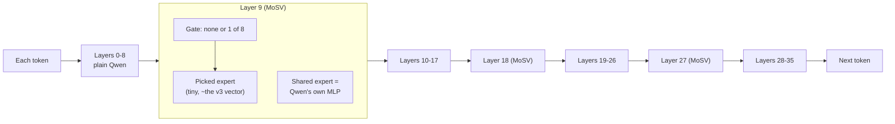

# Mixture of Steering Vectors (MoSV): token-by-token task steering inside Qwen3-4B

*v4 of the steering project: a router inside the model picks one task vector, or none, for every token, in one GGUF
that stock llama.cpp and LM Studio run*

> **At a glance.**
> - **Goal (same as [v3](paper.md)):** squeeze the most out of a small model (Qwen3-4B) by teaching it *how to
>   behave* on each kind of task, without changing what it knows.
> - **What is new:** v3 picked one task vector per prompt, and the whole answer was stuck with it. **v4 picks per
>   token: a Mixture of Steering Vectors (MoSV).** At three layers, a gate inside
>   the model picks one task vector, or none, for every token.
> - **One file:** everything is in one GGUF, stored in a mixture-of-experts (MoE) layout llama.cpp already has. No proxy, no custom code:
>   `llama-server -m <file> -ngl 999 --jinja`. It also runs in LM Studio. It adds 55 MB to the 8 GB model.
> - **Quality:** blind test, 80 prompts: **3.61 against 2.86** for the plain model, 59 wins, 8 ties, 13 losses.
>   The same as v3 (3.54) within the judge's noise.
> - **Switching, proven by a per-token log:** in one conversation the expert follows the task, story (100% of
>   tokens) → debugging (91%) → email (97%), with nothing reloaded. Two tasks inside *one* prompt do not switch
>   cleanly yet.
> - **Honestly:** not a great model. Engineering and how-to are still weak, and it slightly changes prompts it should
>   leave alone. But it is a real, working model, not a demo.

## 1. Same goal, new routing

**The goal has not changed.** Qwen3-4B is a small generalist. It often knows enough for a task but doesn't go about
it the best way. Small steering vectors, one per task, teach it how to operate on each task (how to debug, how to
teach, how to write a story) while the model itself stays frozen and keeps all its knowledge.

**What changed is when the choice is made.**

- **v3, per prompt:** a router read the prompt once and picked one vector. The whole answer was stuck with that
  choice, right or wrong, to the last token.
- **v4, per token:** a Mixture of Steering Vectors (MoSV). A gate inside the model looks at every token, at layers 9, 18 and 27,
  and picks the task vector for that token, or none. The choice can change from token to token and from layer to
  layer.

To be exact about "vector": in v4 each expert is a tiny network (hidden size 128) trained to output its task's v3
vector. It reproduces that vector to within about 2% (section 5.1), so in practice it is a vector picked per token.
It is stored as an MoE expert because that is the form llama.cpp can run without new code.

**About the name.** I call it a *Mixture of Steering Vectors (MoSV)*, not a mixture of experts. It borrows MoE's
router-and-experts shape and its file format, but the experts are not parts of the model doing the work. The whole
model always runs, and the "experts" only add a task's steering direction on top (section 3.3). The name also avoids
*MoV* ("Mixture of Vectors", Zadouri et al., 2023), an earlier and different method. There, each expert is an (IA)³
vector that *multiplies* activations, all experts are blended with router weights, and everything is trained by
supervised fine-tuning. Here, one vector is *added*, it is picked top-1 or none, and it was trained by RL with a judge.

## 2. Why a v4: v3 was hard to use

v3 showed the idea works: small vectors, picked per prompt, made Qwen3-4B noticeably better at five of eight tasks
(see [paper.md](paper.md)). But v3 was hard to actually use:

- **It needed a proxy.** The router was a PyTorch model. To use v3 from any chat app, a Python server had to read each
  prompt on the GPU, pick a vector, then forward the request to llama.cpp.
- **Switching topics reloaded the model.** llama.cpp adds a "control vector" at load time, so each topic was its own
  loaded copy. With room for one copy, every topic switch reloaded 8 GB (about 5-10 s).
- **It was several files.** A base model, 8 vector files, a router checkpoint and a Hugging Face copy of the model for
  the router to read.
- **LM Studio could not run it at all**: it has no control-vector support.

The goal for v4 (my words at the time): one GGUF that llama.cpp runs with no custom code and no proxy.

## 3. How MoSV fits into llama.cpp

### 3.1 Borrowing an MoE layout llama.cpp already has

A mixture-of-experts layer has three parts: a **router** (llama.cpp calls it the gate) that scores each token, a set of
**experts** (small networks), and the rule that adds the picked expert's output to the layer. That is very close to
what v3 does: a router picks one of 8 topics, and the topic's vector is added to the model's internal state.

So instead of writing new code for llama.cpp, v4 fills an existing MoE architecture with the steering. The one that
fits is **`hy_v3`** (Hunyuan v3), checked in llama.cpp's source and in local build b10269:

- Its attention is the same as Qwen3's (same normalisation, same position encoding, same grouped heads).
- Each layer can be a normal (dense) layer or an MoE layer. A layer is MoE only if it has a gate tensor.
- MoE layers keep an always-on **shared expert** next to the picked experts.
- Gating is "sigmoid, top-k, weights normalised". With top-1, the picked expert is added with a weight of exactly 1.

**First check, before training anything:** Qwen3-4B rewritten as `hy_v3`, with MoE at layers 9, 18 and 27, the
original MLP as the shared expert and 9 all-zero experts, gave **5 of 5 identical greedy answers** to the normal
Qwen3 GGUF, at the same speed (18.6 vs 18.8 tokens/s in that run). So the host is exact. Only the new experts and
gates change anything.

### 3.2 What goes where

| MoE part in llama.cpp | Tensor | What v4 puts there |
|---|---|---|
| Router (gate) | `blk.N.ffn_gate_inp` | A linear layer 2,560 → 9: "none" + 8 topics |
| Experts | `blk.N.ffn_{gate,up,down}_exps` | Expert 0 = all zeros ("none"). Experts 1-8 = one small network per topic (hidden size 128) |
| Shared expert | `blk.N.ffn_{gate,up,down}_shexp` | Qwen's original MLP for that layer, unchanged |
| Top-k | `hy_v3` code | Top-1, sigmoid, weight 1 |

Only layers 9, 18 and 27 use the MoE layout (the same places v3 adds its vectors). The other 33 layers stay plain Qwen. The file
is 8.10 GB, 55 MB more than Qwen3-4B in F16.

At each steering layer: `output = Qwen's MLP(x) + expert_k(x)`, where `k` is the gate's pick for that token, and expert 0
adds nothing.

### 3.3 Why it is not a mixture of experts

| | Mixture of experts (MoE) | MoSV (v4) |
|---|---|---|
| Experts | Large, they *replace* the MLP | Tiny, they sit *beside* the full MLP |
| Experts per token | Several | One (and "none" adds nothing) |
| What runs | Part of the model | The whole of Qwen, every time |
| Trained | From scratch with the model | Afterwards, on a frozen model |
| Extra size | The experts are most of the model | +55 MB (0.7%) |

So the claim from v3 still holds: the whole model and all its knowledge are used. The experts change how it works.

### 3.4 Token-by-token routing: the main change

This is the heart of v4, and it is what I wanted.

- **v3** reads the prompt once and picks one vector for the whole answer.
- **v4's** gates pick an expert for **every token**, prompt and answer, at each of the 3 steering layers, independently.
  Each gate sees that token's own internal state, so the pick follows what the model is doing at that moment.

What this gives:
- **No single point of failure.** A v3 router mistake steered the whole answer the wrong way. In v4 a gate's mistake
  touches one token at one layer, and the next token gets a fresh pick.
- **Room for mixed tasks.** A prompt with two jobs (debug this, then write the email about it) can, in principle,
  use the debugging vector on one part and the email vector on the other.

What the switching test showed (section 5.6):
- **Between turns, it switches cleanly.** In one conversation (story, then debugging, then email), the expert in use
  follows each new request: story on 100% of the first answer's tokens, debugging on 91% of the second, email on
  97% of the third. No reload, no router call: the gates do it inside the model.
- **Inside one prompt with two tasks, it only half works.** The gates were taught with one label per prompt (every
  token of a debugging answer was labelled "debugging"), so they never learned to hand over mid-answer. The first
  task mostly falls back to "none", and the second gets its expert only part of the time, flickering token by
  token. Labelling tokens by what each part of an answer is doing, rather than by the prompt, should teach the gates
  to switch on purpose.

## 4. How it was built

v4 was **not** trained with RL. It was taught to copy v3, a method called *distillation*: v3 is the teacher, the gates
and experts are the students. All the build code is in `moe/`. None of it is needed to run the model.

1. **Data** (`moe/make_data.py`, vLLM, one card). From the router's labelled prompts: 200 training and 40 check
   prompts per topic, and twice that for "none" (400 + 80). That is 2,400 prompts. Each was answered greedily, up to
   512 tokens, by v3 itself, with that topic's vector on ("none" with no vector). Total: 1.02 million answer tokens.
2. **Collect** (`moe/train.py`). Run the frozen model over each prompt + v3 answer, with the v3 vector on, and record
   what goes into the MLP at layers 9, 18 and 27 for 96 random tokens per row. Each token is labelled with its
   prompt's topic.
3. **Fit** (`moe/train.py`, one card). Per layer:
   - **Gate:** a linear classifier from that input to the topic (cross-entropy, classes balanced because "none" has
     twice the rows).
   - **Experts:** each topic's expert is trained to output exactly that topic's v3 vector, for every input (mean
     squared error). v3 adds a constant; an expert is a small network, so it has to *learn* to output a constant.
     This works because the MLP input is normalised. Training on all tokens means that if the gate picks the wrong
     topic, that expert still adds roughly the right vector for that topic, not noise.
   - AdamW, learning rate 0.001, 3,000 steps, 4,096 tokens per step.
4. **Export** (`moe/export.py`). Copy every Qwen3 tensor into a `hy_v3` GGUF, rename the MLP at layers 9/18/27 to
   the shared expert, and add the gates and experts (expert 0 = zeros). The Qwen chat template is copied over. The
   gate was trained with softmax but runs with sigmoid in llama.cpp. Both are increasing functions, so they pick the
   same top expert.
5. **Test** (`moe/full_test.py`). The same 86 prompts and the same blind Haiku scoring as v3.

## 5. Results (2026-11-25)

### 5.1 Did the copy work?

Measured on held-out check rows, 96 tokens each:

| Layer | Gate agrees with the topic (all tokens) | Answer tokens only | Expert error vs the v3 vector |
|---|---|---|---|
| 9 | 95.0% | 95.4% | 0.6-1.8% |
| 18 | 99.3% | 99.4% | 0.5-1.0% |
| 27 | 99.4% | 99.5% | 0.7-2.3% |

The experts reproduce the v3 vectors to within about 2%. The gates are right on 95% of tokens at layer 9 and over 99%
at layers 18 and 27. Layers 18 and 27 are easier because layer 9's steering is already in the model's state by then.
About 1 token in 20 at layer 9 gets a different expert. Which one was not measured.

### 5.2 Speed and running it

- **Stock llama.cpp:** `llama-server -m MoSV-Qwen3-4B-F16.gguf -ngl 999 --jinja`. No proxy, no extra files.
- **Full test:** 86 full-length answers, one full copy of the model per card (never split across cards), 6 requests
  at a time per card: 138,947 tokens in 379 s, **367 tokens/s** in total. One answer hit the 8,192-token cap.
- **No reloads:** switching topic is just the gate picking another expert, inside the same loaded model.
- **LM Studio:** its current engine (llama.cpp ROCm runtime 2.80.1) includes `hy_v3`. The model is installed and
  listed as `mosv-qwen3-4b` (arch `hy_v3`, 4.0B, 8.10 GB). Running that engine's own server on the file gives
  steered answers whose openings match stock llama.cpp v4.
- **Openings match v3:** the first sentences of v4's answers match v3's steered answers. They drift later, as any two
  engines do.

### 5.3 Main result: blind scores

Same 80 topic prompts, same rubrics, same normal answers as v3. Claude Haiku saw both answers as "Answer 1" and
"Answer 2" and judged twice, with the order swapped (172 calls, 0 failed, about $0.10). The **normal** column is from
the same scoring run as v4, so v4 and normal were judged side by side. v3 is from its own run, for reference.

| Topic | Normal | v4 | v4 wins / ties / losses | v3 (own run) |
|---|---|---|---|---|
| Debugging | 1.73 | **4.09** | 10 / 0 / 0 | 4.12 |
| Professional email | 3.20 | **4.03** | 10 / 0 / 0 | 4.01 |
| Story | 2.53 | **3.66** | 10 / 0 / 0 | 3.82 |
| Teaching | 2.82 | **3.55** | 9 / 0 / 1 | 3.43 |
| Explanation | 2.72 | **3.49** | 8 / 1 / 1 | 3.45 |
| How-to guide | 2.90 | **3.21** | 7 / 0 / 3 | 2.86 |
| Engineering | 2.44 | 2.41 | 3 / 0 / 7 | 2.18 |
| Math solving | 4.54 | 4.43 | 2 / 7 / 1 | 4.47 |
| **All 80** | **2.86** | **3.61** | **59 / 8 / 13** | **3.54** |

v4 keeps v3's gains. The small differences between v4 and v3 (story down 0.16, how-to up 0.35) are within the
judge's noise (section 6.1), so the fair reading is "v4 ≈ v3", not "v4 is better".

### 5.4 Where the gains come from

Average change per rubric point, v4 against normal (1-5 scale):

- **Debugging:** +3.9 on "separates what the report shows from what is guessed", +3.0 on "says how to check it".
- **Story:** +2.1 on "fresh, specific detail", +1.45 on "holds interest".
- **Professional email:** +1.9 on "covers the supplied key points accurately, with no invented facts".
- **Teaching:** +1.8 on "checks understanding with questions or a short task", but −0.3 on "connects to what the child
  already knows".
- **How-to:** +1.5 on "specific enough to follow", but **−1.05 on "accurate and safe"**.
- **Engineering:** **−0.95 on "looks correct"**: longer projects (6,280 tokens on average against 3,521) with more bugs.

The same pattern as v3: the vectors change structure and habits a lot, and where a topic loses, it loses on
correctness.

### 5.5 Answer length

| Topic | Normal | v4 | v3 |
|---|---|---|---|
| Engineering | 3,521 | 6,280 | 6,450 |
| Debugging | 1,474 | 2,082 | 2,050 |
| How-to | 903 | 1,444 | 1,644 |
| Teaching | 872 | 1,385 | 1,424 |
| Story | 1,059 | 972 | 1,028 |
| Math | 772 | 709 | 587 |
| Explanation | 622 | 405 | 430 |
| Email | 502 | 430 | 436 |

(Average tokens per answer.) v4 writes almost exactly like v3. Email and explanation got shorter and still won, so
"better" is not just "longer".

### 5.6 Proof of switching: which expert fires on each token

llama.cpp does not report which expert it picks. So `moe/switch_test.py` rebuilds v4's exact maths in PyTorch (frozen
Qwen3-4B plus the same gates and experts, same top-1 rule), writes the answers greedily, then logs the expert picked
at every token, at layers 9, 18 and 27. Three cases: one conversation that changes task each turn, and two single
prompts that each ask for two tasks. Full per-token logs: `data_review/reports/v4_switch/`. Every switch point with the
text around it: `results/v4_switches.txt`.

**Share of answer tokens per expert, at layer 27** (the last steering layer):

| Case | Answer | Tokens | Experts used | Switches |
|---|---|---|---|---|
| Conversation, turn 1: "write a story" | Story | 210 | **story 100%** | 0 |
| Conversation, turn 2: "fix my KeyError" | Debugging | 294 | **debugging 91%**, how-to 4%, engineering 3% | 46 |
| Conversation, turn 3: "email my manager" | Email | 155 | **email 97%**, how-to 3% | 10 |
| One prompt: poem + JavaScript bug | Both | 254 | debugging 46%, none 38%, engineering 15% | 80 |
| One prompt: explain photosynthesis + email | Both | 308 | none 86%, email 13% | 33 |

**What this proves:**
- **The routing is real and per token.** Within a single conversation, with nothing reloaded, the expert follows the
  task: story → debugging → email. That is something v3 could not do without a new router call per message.
- **The switch happens while reading the new request.** Each token only sees the text before it. So the first words
  of the second request ("Thanks. Now something different…") still get the story expert, and it flips to debugging
  partway through the request, once the bug is described (story 49%, debugging 42% of that request's tokens). By the
  time the answer starts, debugging is in charge.
- **Short flickers are common.** Inside the debugging answer, the expert jumps to engineering or how-to for one or two
  tokens, mostly on code (`json.load`, `data['users']`) and on step-by-step phrases ("Fix the bug by replacing…"),
  then comes straight back. These are neighbouring tasks, so the flicker is plausible, but it is noise, not a plan.

**What it shows does not work yet:**
- **Poem + bug in one prompt:** the poem never got the story expert. It ran on "none" (51 tokens). The bug part used
  debugging, but kept flipping to none and engineering, sometimes every token (80 switches in 254 tokens).
- **Explanation + email in one prompt:** the explanation part ran entirely on "none" (168 tokens). The email part
  got the email expert on only some tokens, alternating with none (the subject line and greeting alone switched expert 4 times).
- So inside one mixed prompt, the gates sense the second task but do not commit to it, and they don't recognise the
  first task at all. This fits how they were trained: one label per prompt, and mixed prompts never appeared in the
  training data.

**Caveat:** this is a PyTorch copy of v4's maths, not llama.cpp itself. It uses the same weights and the same pick rule,
but the answers it writes drift from llama.cpp's after a while, as any two engines do. The gate picks on a given text
should be the same; this was not checked token by token against llama.cpp.

## 6. Honest notes and limits

### 6.1 The judge is noisy, and this run shows how much

The 6 "none" prompts give a clean measurement of noise. In v3 those answers were word-for-word the normal answers.
Yet the *same normal texts* averaged **3.68** in the v3 scoring run and **4.15** in the v4 scoring run. One answer
went from 2.4 to 3.8. So one prompt's score can move by more than a full point between runs, and a whole topic's
average by a few tenths. This is why v4 vs v3 is called a tie. The comparison that counts is v4 against normal,
judged in the same run.

### 6.2 v4 now touches prompts it should leave alone

In v3, a "none" prompt gave exactly the normal answer. In v4, all 6 "none" answers came out different from the normal
ones, and v4 scored a little lower on them (4.15 → 3.95: 0 wins, 2 ties, 4 losses).

Two causes are mixed here, and I did not separate them:
1. **Engines.** The normal answers were written by vLLM, v4's by llama.cpp. They round numbers differently, so even
   an exact copy of the plain model drifts after a sentence or two (this was seen in v3's llama.cpp check too).
2. **Gates.** Per-token gates can pick a topic expert for some tokens of a "none" prompt.

The fix for cause 1 is to write the normal answers with plain Qwen in llama.cpp. The fix for cause 2 would be to log
which experts fire on "none" prompts. Neither is done yet.

### 6.3 Other limits

- **It is a copy of v3, so it cannot beat v3 by design.** Distillation only aims to match the teacher. Any real gain
  over v3 would need RL training of the experts themselves (the v3 recipe), which was not needed to reach v3's level
  and was not done.
- **Same weak topics.** Engineering (bad training data) and how-to (accuracy) are still weak, and math ties because
  the base model is already strong there. v4 inherited v3's vectors, so it inherited their flaws.
- **Small test, one judge, one run.** 10 prompts per topic, Claude Haiku as the only judge, plus my own non-blind
  reading.
- **No per-request override.** v3 let you send `"steer": "none"` or a topic. v4 cannot: to run unsteered, load the
  plain Qwen GGUF.
- **Flicker.** Even on one-task answers the expert flips for a token or two, often on code (section 5.6). Scores
  held, but it is noise.
- **Mixed prompts don't work well yet.** In one prompt with two tasks, the first task ran on "none" and the second got
  its expert only part of the time (section 5.6). Switching between turns of a conversation does work.
- **It shows up as `hy_v3`, not `qwen3`.** llama.cpp builds and LM Studio runtimes without `hy_v3` cannot load it.
- **F16 only.** No quantised version (for example Q8_0) yet, so it needs about 8 GB of VRAM.

## 7. What v4 changes, in one table

| | v3 (proof of concept) | v4 (real model) |
|---|---|---|
| Files | Base GGUF + 8 vectors + router + HF copy | **One GGUF** |
| Runs in | llama.cpp + a Python proxy | **Stock llama.cpp, LM Studio's engine** |
| Routing | Once per prompt; the answer is stuck with it | **Every token, at 3 layers (MoSV)** |
| Router | Separate PyTorch model | **Gates inside the model** |
| Topic switch | Reloads the model (5-10 s) | **Free, inside the same model** |
| "None" prompts | Exactly the plain model | Slightly changed (section 6.2) |
| Override | `"steer"` field | None |
| Extra size | 8 × 31 KB vectors | +55 MB |
| Score (80 prompts) | 3.54 | 3.61 (same, within noise) |
| Trained by | RL with Haiku as judge | Copied from v3 (distillation) |

## 8. Next steps

1. **Fair "none" test:** write the normal answers with plain Qwen in llama.cpp, and log which experts fire on "none"
   prompts. This separates engine drift from gate mistakes.
2. **Quantise** to Q8_0 (and try Q4) with `llama-quantize`, then rerun the blind test to see what quality survives.
3. **Teach real switching inside one prompt.** Build training answers that do two tasks in a row, label each token
   by the part of the answer it belongs to (not by the prompt), and retrain the gates. Then rerun the switching test
   (section 5.6). A smoothing term that punishes one-token flips would also cut the flicker.
4. **RL on the experts directly**, starting from the copied ones, to go past v3 instead of matching it.
5. **Better engineering data**, then retrain that one topic. The weakest topic is a data problem, not a method
   problem.
6. **Publish** the GGUF on Hugging Face, with this write-up as its model card.

## 9. How to reproduce

Code is on branch `v4-moe`. Training and data steps run in WSL on one card (see the README environment). Export and
testing run on Windows.

1. `python moe/make_data.py`: 2,400 prompts answered by v3 (vLLM, one card).
2. `python moe/train.py`: collect the MLP inputs, then fit gates and experts → `checkpoints/moe_v4/moe.pt`.
3. `python moe/export.py <Qwen3-4B-Instruct-2507-F16.gguf> <out.gguf> --moe checkpoints/moe_v4/moe.pt`
   (gguf-tools venv). Without `--moe` it writes the all-zero host model, which should match plain Qwen exactly.
4. `python moe/full_test.py <out.gguf>`: 86 full answers in stock llama-server, one copy per card.
5. `python reports/score_full.py --answers data_review/reports/v4_full_test.json --out data_review/reports/v4_scores.json`

6. `python moe/switch_test.py`: the per-token switching test (section 5.6), Windows ROCm venv, one card.

The README's "Build v4" section has the exact commands, package versions and sha256 checksums of every file behind
these results. Light tests with no GPU: `python -m pytest test_moe.py`.

What repeats exactly: the data sample, and the export (re-exporting the same `moe.pt` gives the same GGUF, byte for
byte). What repeats closely but not exactly: training (seeded, but GPU sums differ in the last bits). What doesn't
repeat: Haiku's scores (section 6.1), and long answers across engines and runs.

Model download and dataset links: to be added.

## References

- Meral, T. H. S., Oktay, K., Helbling, A., Kara, A., Chau, D. H., Yanardag, P. (2026). *RL Post-Training in
  Diffusion Transformers Is Activation Steering.* arXiv:2611.26627.
- Zadouri, T., Üstün, A., Ahmadian, A., Ermiş, B., Locatelli, A., Hooker, S. (2023). *Pushing Mixture of Experts to
  the Limit: Extremely Parameter Efficient MoE for Instruction Tuning.* arXiv:2309.05444. (MoV, related work.)
- The v3 write-up: [paper.md](paper.md).
- llama.cpp, `hy_v3` architecture (Hunyuan v3), build b10269.
