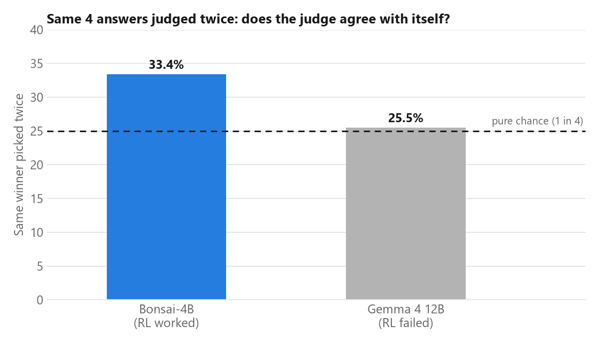
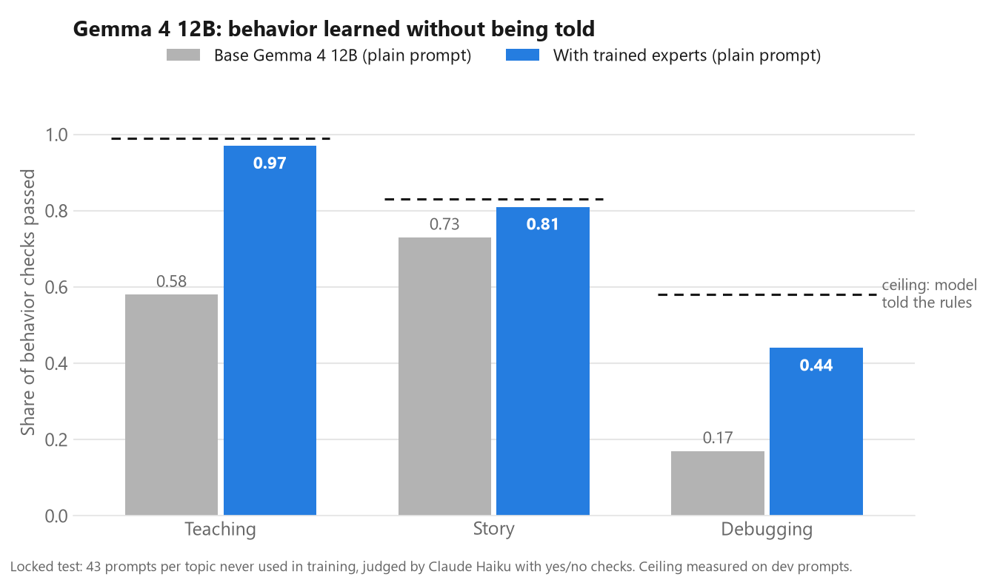
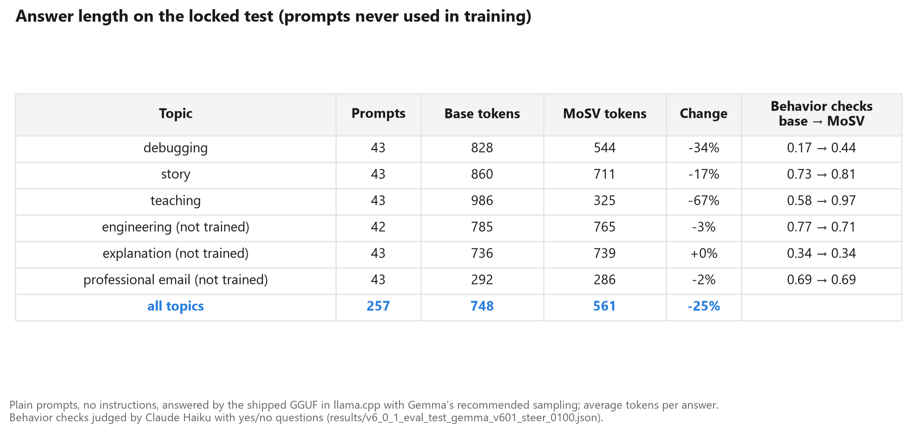
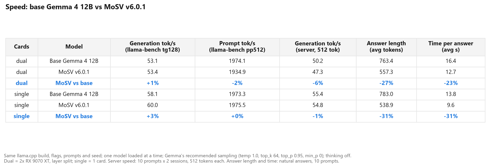
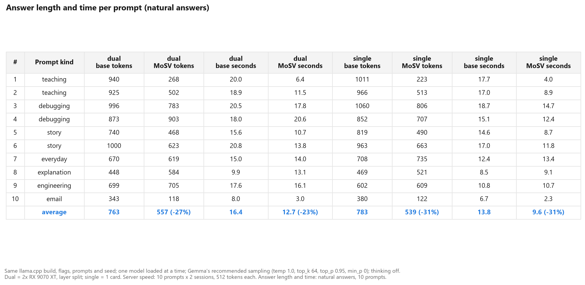

# MoSV v6.0.1: teaching a strong model behaviors it already has, without telling it

*Gemma 4 12B with three trained steering experts (debugging, teaching, story), one GGUF for stock llama.cpp and
LM Studio. And why the RL method that worked on small models failed here.*

> **At a glance.**
> - **Model:** Gemma 4 12B, frozen, plus three small experts (debugging, teaching, story) at layers 12, 24 and 36,
>   chosen per token by a router. One GGUF: the Q4_K_M base plus 36 MB.
> - **Locked test (300 prompts never used in training, plain prompts, nothing told to the model, answered by the
>   GGUF in llama.cpp).** Share of behavior checks passed, base → trained:
>   **teaching 0.58 → 0.97** (trained better on 98% of prompts), **debugging 0.17 → 0.44** (81%),
>   **story 0.73 → 0.81** (62%).
> - **Shorter answers, same speed.** On the locked test, answers are 25% shorter overall (748 → 561 tokens;
>   teaching 986 → 325). In a controlled speed test in llama.cpp, MoSV generates tokens as fast as base Gemma
>   (llama-bench: 60.0 vs 58.1 tok/s on one card), so a full answer arrives about 31% sooner (13.8 → 9.6 s).
> - **The method that worked is plain supervised training,** not RL: the model writes answers while told the rules,
>   a judge checks them, only verified better answers are kept, and the experts learn them from the plain prompt.
> - **The method that failed:** the RL recipe that improved Qwen3-4B and Bonsai-4B gave no gain on Gemma. The test
>   had almost no room on its old 1-5 score, and the judge's choices were at chance level.
> - **Honestly:** teaching answers are slightly less often correct (0.95 → 0.91), and engineering, a topic that was
>   not trained, got worse on the locked test (0.77 → 0.71), most likely because some of its tokens are routed to
>   the debugging expert.

## 1. Goal

Same as every MoSV version: keep a model frozen and teach it **how to answer** a kind of task, not new facts. A
router inside the model picks one expert per token, or "none", in which case the model answers as it always does.
Everything ships as one GGUF in a layout llama.cpp already supports (v4: [paper_v4.md](paper_v4.md)).

v6 asks whether this scales from small models (Qwen3-4B, Bonsai-4B 1-bit) to a strong one: Gemma 4 12B.

## 2. The first attempt failed, and why (v6.0)

v6.0 used the v5 recipe unchanged: sample 4 answers per prompt, Claude Haiku scores and ranks them, the better ones
are reinforced (group-relative RL). Seven topics, the model's recommended sampling, thinking off.

Two runs (125 and 96 updates) gave **no gain**: on 140 dev prompts, base 3.39 and checkpoints 3.30 to 3.41 on the
judge's 1-5 score.

Four measurements explain it:

| Measurement | Result | Meaning |
|---|---|---|
| Room on the test: Gemma / Gemma told the rubric / Haiku itself | 3.38 / 3.46 / 3.71 | Almost nothing left to win on a 1-5 overall score |
| Same 4 answers judged twice: same winner | 25.5% (chance 25%); Bonsai: 33.4% | The reward was noise |
| Two separate answers to one prompt, score correlation | 0.86; best of 6 only 0.2-0.5 above average | A strong model makes the same answer every time; RL has nothing better to pick |
| Expert strength after 94 updates | 0.304 per dimension; a random walk predicts 0.291 | The parameters wandered; they did not learn |



The plumbing was sound: the experts act the same in PyTorch and in the GGUF (agreement 0.81), and the one-answer
scorer repeats itself (88% identical scores). The method did not fit the model. The full account:
[docs/V6_GEMMA.md](../docs/V6_GEMMA.md).

## 3. The fix: measure, tell, check, train (v6.0.1)

### 3.1 Behaviors instead of a score

For each topic, one file holds the **rules** (told to the model), **four yes/no behavior checks** and **one
correctness guard**. Examples:

| Topic | A behavior check | The guard |
|---|---|---|
| Teaching | Does the answer speak to the child directly, instead of describing a lesson plan to a teacher? | Are the facts taught correct? |
| Debugging | Does it separate what the report states from what the writer is guessing? | Does it stay on this report and propose a concrete cause or fix? |
| Story | Does the opening start with an action, a voice or a specific image, instead of weather or mood? | Does it fit the request and make sense? |

Haiku answers the questions about one answer at a time. Judged twice, it gives the same yes/no **95-98%** of the
time, against 25.5% for the old ranking.

### 3.2 The gate: is there anything to teach?

Before training, every topic is measured three ways on 60 dev prompts: the plain model, the model **told** the
rules, and Haiku answering itself. A topic is trained only if told beats plain by 15+ points, correctness drops by
at most 10, and the checker repeats 85%+.

| Topic | Plain | Told | Verdict |
|---|---|---|---|
| Teaching | 0.56 | 0.99 | train |
| Debugging | 0.17 | 0.58 | train |
| Story | 0.66 | 0.83 | train |
| Explanation | 0.34 | 0.64-0.69 | borderline: passed one gate run, failed the next on correctness |
| Engineering | 0.75 | 0.89-0.91 | borderline: failed one run by one point, passed the next |
| Email | 0.65-0.68 | 0.73-0.77 | skip |
| Math | | | not a behavior (ability); never trained |

Only the three clear passes were trained. The told column is the **ceiling**: an expert can move the model toward
what it already does when asked, not beyond.

### 3.3 Building the training set

For 300 training prompts per topic, the model writes one plain answer and two told answers. A told answer is kept
only if it ended on its own, passes the guard, passes at least 3 of 4 checks, passes more checks than the plain
answer to the same prompt, and (for stories) does not repeat an opening style or a character name too often.

| Topic | Kept | Checks passed, plain → kept | Tokens, plain → kept |
|---|---|---|---|
| Debugging | 221 / 300 | 0.22 → 0.84 | 822 → 487 |
| Teaching | 272 / 300 | 0.56 → 1.00 | 994 → 271 |
| Story | 181 / 300 | 0.66 → 0.96 | 901 → 650 |

The variety limit exists because the first story rule ("first sentence = an action or a line of speech") made
100% of kept stories open with a quote and put the name *Elias* in 60% of them. With the rewritten rule, 0% open
with speech and no name appears in more than 5%.

### 3.4 Training

Supervised next-token training on the kept answers, shown with the **plain** prompt only (no rules), in the
model's own chat format. Loss only on the answer and its stop token. AdamW, experts lr 1e-3, strength lr 3e-3,
16 answers per step, 3 epochs (117 steps), 4-bit learner on one RX 9070 XT, about 19 s per step.

The router (layers 12, 24, 36) is fitted first on recorded answers, with everyday prompts, math and all untrained
topics labeled "none". Held-out accuracy: 83% / 97% / 97%.

Held-out loss on 63 answers never trained on: plain model 1.218, plain model **told the rules** 0.684, trained:

| Step | 25 | 50 | 75 | 100 | 117 |
|---|---|---|---|---|---|
| Loss | 0.866 | 0.709 | 0.652 | 0.651 | 0.642 |

## 4. Results

### 4.1 Picking the checkpoint (dev, 60 prompts per topic)

| Topic | Base | 25 | 50 | 75 | **100** | 117 | Told |
|---|---|---|---|---|---|---|---|
| Teaching | 0.58 | 0.60 | 0.87 | 0.97 | **0.99** | 0.98 | 0.99 |
| Story | 0.68 | 0.72 | 0.78 | 0.79 | **0.82** | 0.80 | 0.83 |
| Debugging | 0.16 | 0.25 | 0.26 | 0.32 | **0.40** | 0.40 | 0.58 |

The loss fell smoothly, but the generated answers lagged: at step 25 the loss had closed two thirds of the gap
while the answers had barely changed. Step 100 was best or tied best on all three topics.

### 4.2 Locked test (the final result)

300 prompts locked before any training, plain prompts, the same sampling as the baseline, answered by the shipped
GGUF in llama.cpp, each answer judged alone.

| Topic | Behavior, base → trained | Trained better on | Guard, base → trained | Tokens, base → trained |
|---|---|---|---|---|
| **Teaching** | 0.58 → **0.97** | **98%** | 0.95 → 0.91 | 986 → 325 |
| **Debugging** | 0.17 → **0.44** | **81%** | 0.98 → 0.95 | 828 → 544 |
| **Story** | 0.73 → **0.81** | **62%** | 1.00 → 1.00 | 860 → 711 |
| Explanation (not trained) | 0.34 → 0.34 | 50% | 0.70 → 0.81 | 736 → 739 |
| Email (not trained) | 0.69 → 0.69 | 49% | 1.00 → 0.98 | 292 → 286 |
| Engineering (not trained) | 0.77 → 0.71 | 39% | 0.69 → 0.79 | 785 → 765 |



Single checks on the locked test, base → trained:

| Topic | Check | Base | Trained |
|---|---|---|---|
| Teaching | Speaks to the child directly | 0.02 | **1.00** |
| Teaching | Language right for the grade | 0.47 | **1.00** |
| Debugging | Says how to check or confirm a cause | 0.26 | **0.79** |
| Debugging | Names nothing as fact that is not in the report | 0.00 | 0.23 |
| Debugging | Separates the report from the guesses | 0.00 | 0.12 |
| Story | Opens with an action, a voice or a specific image | 0.19 | 0.33 |
| Story | Shows feelings through action or dialogue | 0.81 | 0.93 |

### 4.3 Working inside the model

Measured inside llama.cpp on the shipped GGUF (`v6/verify.py`, 3 dev prompts per topic + 3 everyday prompts,
48 tokens each; `results/v6_0_1_verify_upd100.json`). For each prompt kind: how much the experts change llama.cpp's
own next-token probabilities, and how often they change its top choice.

| Prompts | Change in next-token log-probability | Top token changed |
|---|---|---|
| **Teaching** (trained) | 1.97 | 22% |
| **Debugging** (trained) | 1.79 | 33% |
| **Story** (trained) | 1.63 | 28% |
| Explanation, email, engineering, math (not trained) | 0.13-0.20 | 0-2% |
| Everyday questions (not trained) | 0.21 | 0% |

The router sends trained topics to their experts and leaves everything else close to the plain model. The same
experts measured in PyTorch agree with llama.cpp at 0.89 (correlation of their effect), so what was trained is
what ships. A chat demo through `llama-server --jinja` with hand-written prompts (`results/v6_0_1_demo.md`):
teaching 1,011 → 223 tokens and addressed to the child; the everyday and coding answers keep the same content
and structure as plain Gemma.

### 4.4 Speed and answer length

**Answer length is a key improvement.** The trained behaviors cut the padding: teaching stops writing a lesson
plan for a teacher, debugging stops listing every possible cause, and stories drop the scene-setting. On the
locked test (prompts never used in training), answers are **25% shorter overall**, while untrained topics keep
their length (within 3%):



**The experts cost no speed.** A controlled test (`reports/speed_v6_0_1.py`): the same llama.cpp build and flags,
one model loaded at a time, the same 10 hand-written prompts, Gemma's recommended sampling with every sampler set
explicitly, a fixed seed, thinking off and no prompt cache. Speed is measured three ways: llama-bench (5 repeats),
the server at a fixed 512 tokens per answer (2 sessions per model in the order base, MoSV, MoSV, base, so drift hits
both equally), and natural answers where each model stops on its own. This was done on two cards (layer split) and
on one card.



| One card (RX 9070 XT) | Base | MoSV | Change |
|---|---|---|---|
| Generation, llama-bench tg128 | 58.1 tok/s | 60.0 tok/s | +3% (within noise) |
| Prompt reading, llama-bench pp512 | 1,973 tok/s | 1,975 tok/s | 0% |
| Answer length (10 prompts) | 783 tokens | 539 tokens | **-31%** |
| Time per answer | 13.8 s | 9.6 s | **-31%** |

- The three small experts and routers (36 MB) add no measurable cost: token speed is the same within noise on one
  card and on two (dual: 53.4 vs 53.1 tok/s generation, -2% prompt reading).
- Because answers are shorter, a full answer arrives about 31% sooner on one card and 23% sooner on two.
- No answer was cut off: all 40 natural answers ended on their own (longest 1,060 tokens, limit 2,048).
- One card is faster than two for this 7 GB model (58 vs 53 tok/s): it fits on one card, and splitting adds
  card-to-card traffic.
- Server speed at fixed length varies ±10% between sessions of the same model on the same prompt (measured), so
  llama-bench is the cleaner speed figure.

Per prompt (natural answers):



All requests, answers and raw llama.cpp logs: `results/speed_v6_0_1/` (`README.md`, `speed.json`, `outputs.md`,
`*_server.log`, `*_bench.log`).

### 4.5 What this means

- **Teaching reached its ceiling.** The model now teaches a child directly in about a third of the words, as it
  does when told, without being told.
- **Debugging more than doubled** and the answers got shorter, but it stays below its ceiling (0.44 against 0.58).
  The hardest behavior, separating facts from guesses, moved least.
- **Story moved most of the way** to its ceiling (0.81 against 0.83).
- **Shorter and no slower:** trained topics answer in 17-67% fewer tokens at the same token speed, so answers
  arrive sooner.
- **Untrained topics:** explanation and email are unchanged. **Engineering lost ground** (0.77 → 0.71, trained
  better on only 39%); on dev it had gained (0.75 → 0.79). Its prompts are close to debugging's, and the router at
  layer 12 keeps only 71% of "none" tokens as "none". A router fitted with engineering as its own "none" group is
  the first fix to try.

## 5. Honest notes and limits

- **One judge.** Every score is Claude Haiku's. The checks repeat well, but a second judge model would be a
  stronger test.
- **Behavior, not quality.** The checks measure the behaviors we chose. Whether people prefer the answers was not
  measured. The old 1-5 overall score was not rerun on the trained model.
- **Correctness cost on teaching:** 0.95 → 0.91 on the locked test (2 more answers with a wrong fact out of 43).
  Told answers show a similar cost, so it comes with the behavior.
- **Small per-topic samples:** 43 prompts per topic on the locked test, 60 on dev.
- **Debugging prompts have no code.** They are bug reports, so the target behavior is honest analysis, not a
  verified fix.
- **Engineering leak** (section 4.5).
- **Speed test:** one machine (2x RX 9070 XT, Vulkan), 10 prompts. Shorter is better here because the trained
  behaviors ask for it (teach the child, not a lesson plan); it is not a general claim that shorter is better.

## 6. What v6.0.1 changes, in one table

| | v5 (Bonsai-4B) | v6.0 (Gemma, failed) | **v6.0.1 (Gemma)** |
|---|---|---|---|
| Training | RL, judge ranks 4 answers | Same | **Supervised on checked told answers** |
| Target | 1-5 rubric score | Same | **Yes/no behavior checks + a correctness guard** |
| Before training | Nothing | Nothing | **Gate: plain vs told vs a strong model** |
| Judge repeats itself | 33% same winner | 25.5% (chance) | **95-98% same yes/no** |
| Result | 66% of prompts better | No gain | **Teaching 98%, debugging 81%, story 62% better** |
| Answer length / speed | 4x shorter | - | **25% shorter, same token speed, answers ~31% sooner** |

## 7. Reproduce

Windows, `ai-training-rocm-windows` venv, from the repo root (full commands and pass rules:
[docs/REFERENCE.md](../docs/REFERENCE.md); rules: [docs/TRAINING_BIBLE.md](../docs/TRAINING_BIBLE.md)):

```
python -m v6_0_1.gate
python -m v6_0_1.build_data --per-topic 300 --copies 2 --topics debugging teaching story --fresh
python -m v6_0_1.train --run gemma_v601
python -m v6_0_1.evaluate --run gemma_v601 --checkpoint steer_0100.pt --split dev --fresh
python -m v6_0_1.evaluate --run gemma_v601 --checkpoint steer_0100.pt --split test
python reports/speed_v6_0_1.py          # speed test (both cards free, nothing else loaded)
python reports/speed_chart_v6_0_1.py    # table images
```

Run it: `llama-server -m MoSV-Gemma-4-12B-v6.0.1-Q4_K_M.gguf -ngl 99 -fa on --jinja`, with the model's recommended
sampling (temperature 1.0, top_k 64, top_p 0.95, min_p 0) and thinking off.

Results files: `results/v6_0_1_gate.json`, `results/v6_0_1_data.json`,
`results/v6_0_1_eval_dev_gemma_v601_steer_*.json`, `results/v6_0_1_eval_test_gemma_v601_steer_0100.json`.

## References

- T. H. S. Meral, K. Oktay, A. Helbling, A. Kara, D. H. Chau, P. Yanardag. *RL Post-Training in Diffusion
  Transformers Is Activation Steering.* arXiv:2611.26627.
- Google DeepMind. *Gemma 4.* Apache 2.0.
- MoSV v3 and v4: [paper.md](paper.md), [paper_v4.md](paper_v4.md).
