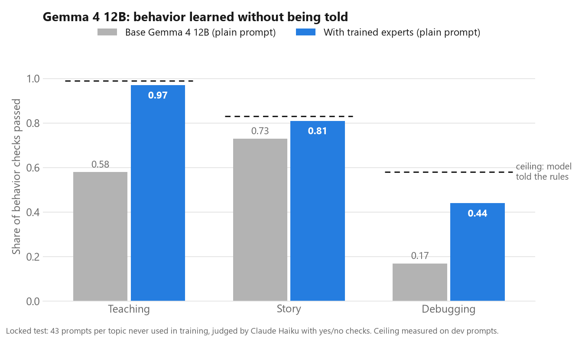

# MoSV-Gemma-4-12B v6.0.1

**Gemma 4 12B with three small steering experts that teach it how to answer debugging, teaching and story
prompts, without being told.** One GGUF that stock llama.cpp and LM Studio run. Research release.

Part of **MoSV (Mixture of Steering Vectors)**: the base model stays frozen; small experts at three layers
(12, 24, 36) are picked per token by a router, or "none", in which case the model answers as plain Gemma.
Code and full write-up: [github.com/mhndayesh/mosv](https://github.com/mhndayesh/mosv) ·
paper: [paper_v6_0_1.md](https://github.com/mhndayesh/mosv/blob/main/paper/paper_v6_0_1.md) ·
earlier versions: [mhndayesh/mosv](https://huggingface.co/mhndayesh/mosv).

## What the experts do

| Topic | Behavior taught |
|---|---|
| **Teaching** ("Teach X to a Primary N student") | Speaks to the child directly at the right level, small steps, checks understanding, instead of writing a lesson plan for a teacher |
| **Debugging** (bug reports) | Ties causes to clues in the report, says how to confirm them, separates facts from guesses, invents fewer names |
| **Story** | Opens on something specific instead of weather or mood, shows feelings through action, no moral at the end |

Everything else (everyday questions, math, code, email, explanations) is routed to "none".

## Results

Locked test: 300 prompts set aside before any training, plain prompts (no instructions), answered by this GGUF in
llama.cpp with Gemma's recommended sampling, each answer judged alone by Claude Haiku with yes/no behavior checks
and a correctness check.

| Topic | Behavior checks passed, base → MoSV | MoSV better on | Correctness, base → MoSV | Answer tokens |
|---|---|---|---|---|
| **Teaching** | 0.58 → **0.97** | **98%** of prompts | 0.95 → 0.91 | 986 → 325 |
| **Debugging** | 0.17 → **0.44** | **81%** | 0.98 → 0.95 | 828 → 544 |
| **Story** | 0.73 → **0.81** | **62%** | 1.00 → 1.00 | 860 → 711 |
| Explanation (not trained) | 0.34 → 0.34 | 50% | 0.70 → 0.81 | 736 → 739 |
| Email (not trained) | 0.69 → 0.69 | 49% | 1.00 → 0.98 | 292 → 286 |
| Engineering (not trained) | 0.77 → 0.71 | 39% | 0.69 → 0.79 | 785 → 765 |



The dashed line is the **ceiling**: plain Gemma *told* the rules in a system prompt. Teaching and story reach it
without any instructions.

## Checked inside the GGUF

Measured inside llama.cpp on the shipped GGUF (`v6/verify.py`, 3 dev prompts per topic + 3 everyday prompts,
48 tokens each; `results/v6_0_1_verify_upd100.json`). For each prompt kind: how much the experts change llama.cpp's
own next-token probabilities, and how often they change its top choice.

| Prompts | Change in next-token log-probability | Top token changed |
|---|---|---|
| **Teaching** (trained) | 1.97 | 22% |
| **Debugging** (trained) | 1.79 | 33% |
| **Story** (trained) | 1.63 | 28% |
| Explanation, email, engineering, math (not trained) | 0.13-0.20 | 0-2% |
| Everyday questions (not trained) | 0.21 | 0% |

The router sends trained topics to their experts and leaves everything else close to the plain model. The same
experts measured in PyTorch agree with llama.cpp at 0.89 (correlation of their effect), so what was trained is
what ships. A chat demo through `llama-server --jinja` with hand-written prompts (`results/v6_0_1_demo.md`):
teaching 1,011 → 223 tokens and addressed to the child; the everyday and coding answers keep the same content
and structure as plain Gemma.

## Use

```
llama-server -m MoSV-Gemma-4-12B-v6.0.1-Q4_K_M.gguf -ngl 99 -fa on --jinja
```

Use Gemma's recommended sampling: temperature 1.0, top_k 64, top_p 0.95, min_p 0. Thinking off
(`chat_template_kwargs: {"enable_thinking": false}`) is how it was trained and tested. In LM Studio, load the file
as any GGUF.

| | |
|---|---|
| File | `MoSV-Gemma-4-12B-v6.0.1-Q4_K_M.gguf` |
| Size | 7.16 GB (Gemma 4 12B Q4_K_M + 36 MB of experts and routers) |
| sha256 | `8c89bf0b1f10281e6c1bf5a7a835eea50aa73d7010bee3c4bdb6f2c104e5657e` |
| Architecture | `gemma4` with per-layer MoE at layers 12, 24, 36: 4 experts each (none, debugging, story, teaching), top-1 |

## How it was trained

1. **Gate:** for each topic, compare Gemma answering plainly with Gemma *told* the rules, on 60 dev prompts. Only
   topics where being told clearly helps are trained.
2. **Data:** Gemma answers 300 training prompts per topic while told the rules. Haiku checks every answer with
   yes/no questions; only answers that pass, stay correct, and beat the plain answer are kept (674 of 900).
3. **Training:** supervised (like a LoRA), on the plain prompt only, so the behavior appears without instructions.
   117 steps, frozen 4-bit base, one RX 9070 XT.

An earlier attempt with RL (a judge ranking sampled answers) gave no gain on this model; why is in the paper.

## Limits

- Judged by one model (Claude Haiku). The checks measure the chosen behaviors, not overall preference.
- Teaching answers are slightly less often fully correct (0.95 → 0.91).
- **Engineering prompts are affected although not trained** (0.77 → 0.71 on the locked test); likely some code
  tokens are routed to the debugging expert. Use plain Gemma for coding.
- Debugging prompts in the data are bug reports without code, so the behavior is careful analysis, not verified fixes.
- English only; 43 test prompts per topic.

## License

**Code, MoSV experts, routers and steering vectors: MIT** (free to use, change and sell, keep the notice). The GGUF also contains the base model's weights, which stay under Gemma 4's Apache 2.0; that license also allows commercial use. Built on [google/gemma-4-12B-it](https://huggingface.co/google/gemma-4-12B-it).

## Credit

Idea from T. H. S. Meral et al., *RL Post-Training in Diffusion Transformers Is Activation Steering*,
arXiv:2611.26627.
